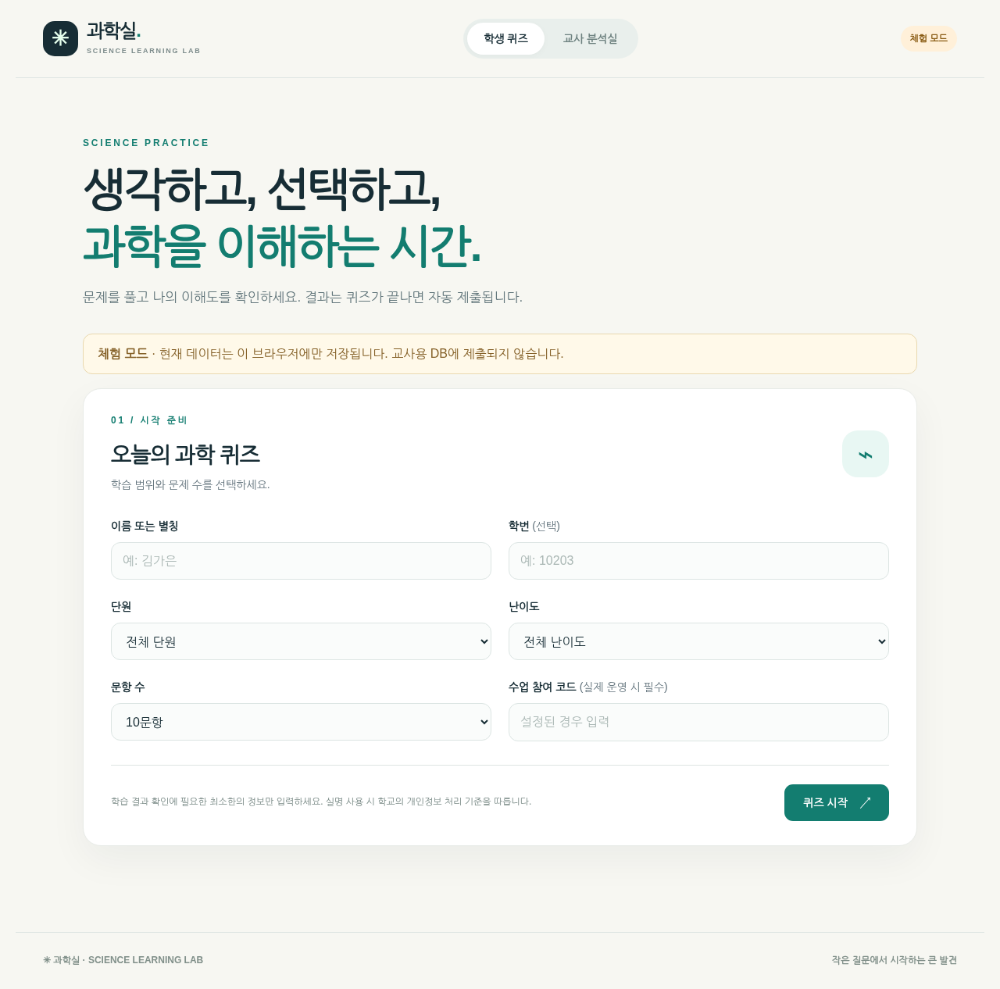

# 과학실 · Science Learning Lab

중학교 과학 **퀴즈 + 결과 자동 제출 + 학생·문항·단원 분석**을 한 웹사이트에 통합한 GitHub Pages / Supabase 프로젝트입니다.



> **현재 상태:** 브라우저에서 작동하는 데모를 포함한 **배포용 초안(MVP)**입니다. 실서비스 Supabase 인증·저장·동시 요청은 실제 계정에서 아직 통합 테스트하지 않았습니다. 학생 실명·성적을 수집하기 전에 교사가 가상 학생으로 충분히 검증하고 학교 개인정보 처리 기준을 확인해야 합니다.

## 동작 방식

- **GitHub Pages:** 학생용 퀴즈, 교사용 대시보드 UI를 무료로 호스팅합니다.
- **Supabase Auth:** 관리자로 등록된 교사만 로그인합니다.
- **Supabase Database:** 비공개 문제은행과 학생 응답을 저장합니다.
- **Supabase Edge Function:** 정답을 노출하지 않고 문제를 출제·채점하고 결과를 영구 저장합니다.
- **데모:** DB 설정 전에는 30개 샘플 문제로 브라우저 체험 가능합니다. 실제 결과는 저장되지 않고 현재 브라우저에만 남습니다.

## 1. GitHub 웹사이트 먼저 올리기

1. [github.com/new](https://github.com/new)에서 공개(Public) 저장소 `science-quiz`를 만듭니다.
2. 이 프로젝트의 **전체 폴더 구조를 유지하여** 파일을 업로드합니다. GitHub 웹 UI에서 **Add file → Upload files → Commit changes**를 선택합니다. ZIP을 압축 해제한 뒤 내부 파일을 올리세요.
3. 저장소의 **Settings → Pages → Build and deployment → Deploy from a branch**를 선택합니다.
4. **Branch `main`, Folder `/(root)`, Save**를 선택합니다.
5. 잠시 후 `https://<GitHub사용자이름>.github.io/science-quiz/`에 접속합니다.
6. 데이터베이스 연결 전에는 자동으로 **체험 모드**가 켜집니다. 학생 화면과 교사 샘플 분석 화면을 확인합니다.

## 2. Supabase 프로젝트 만들기

1. [supabase.com/dashboard](https://supabase.com/dashboard)에서 새 프로젝트를 생성합니다.
2. **SQL Editor**를 열고 `supabase/schema.sql` 전체 내용을 실행합니다.
3. **Authentication → Users**에서 교사용 이메일 계정을 만듭니다. 비밀번호 및 이메일 인증을 완료합니다. 공개 가입 기능은 비활성화하는 것이 좋습니다.
4. **SQL Editor**에서 아래 문장을 교사 이메일로 변경해서 실행합니다.

   ```sql
   insert into public.teacher_accounts(user_id)
   select id from auth.users where email = '실제_교사이메일@example.com'
   on conflict (user_id) do nothing;
   ```

   계정이 아직 없으면 아무 행도 삽입되지 않습니다. `select * from public.teacher_accounts;`로 확인하세요.

5. Supabase **Project Settings → API Keys** 또는 연결(Connect) 정보에서 **Project URL**과 **publishable key (`sb_publishable_...`)**를 확인합니다.

> **절대** `service_role` / `sb_secret_...` 키를 GitHub, `config.js`, 브라우저 또는 학생에게 공개하지 마세요.

## 3. Supabase Edge Function 게시

### 브라우저만 이용하는 방법

1. Supabase 프로젝트의 **Edge Functions → Deploy a new function → Via Editor**로 들어갑니다.
2. 함수 이름을 **`quiz-api`**로 정합니다.
3. 에디터 내용을 `supabase/functions/quiz-api/index.ts`의 내용으로 바꿉니다.
4. Deploy 합니다.
5. 함수 설정에서 **Verify JWT**를 **OFF**로 설정합니다. 이 함수는 학생용 익명 요청도 받기 때문입니다. 교사 요청은 함수 내부에서 Supabase Auth와 `teacher_accounts`를 매번 검증합니다.
6. **Edge Functions → Secrets**에서 다음 두 값을 저장합니다.
   - `ALLOWED_ORIGINS`: `https://<GitHub사용자이름>.github.io` (경로 `/science-quiz`는 넣지 않음)
   - `QUIZ_ACCESS_CODE`: 교사가 학생들에게 알려줄 충분히 긴 수업 코드 (예: 임의의 단어/숫자 조합). **실제 운영 시 필수**

> 미리보기 도메인을 따로 쓸 경우 `ALLOWED_ORIGINS`에 쉼표로 구분하여 정확한 도메인 Origin을 추가하세요. Chrome 개발자도구에서 보이는 Origin 문자열 기준입니다.

### 명령줄 이용 시 (선택)

```bash
npx supabase login
npx supabase link --project-ref 프로젝트_REF
npx supabase secrets set ALLOWED_ORIGINS=https://사용자이름.github.io QUIZ_ACCESS_CODE=원하는_수업코드
npx supabase functions deploy quiz-api --no-verify-jwt
```

CLI로 배포할 때 `supabase/config.toml`에서도 JWT 검증이 꺼져 있습니다. 보안 책임은 `index.ts`의 교사 인증 코드와 수업 코드 검사에 있습니다.

## 4. GitHub에서 서비스 연결

GitHub 저장소 `config.js`를 편집합니다.

```js
window.SCIENCE_QUIZ_CONFIG = {
  supabaseUrl: "https://xxxxxxxx.supabase.co",
  supabasePublishableKey: "sb_publishable_xxxxxxxxxxxx",
  functionName: "quiz-api"
};
```

`Commit changes`를 누르면 GitHub Pages 사이트가 재배포됩니다. 새로고침 후 상단에 **온라인 연결**이 나타나는지 확인합니다.

**주의:** GitHub Pages 도메인과 `ALLOWED_ORIGINS` 값이 맞지 않으면 웹 브라우저에서 CORS 오류가 발생합니다. 이때 Supabase Secrets의 `ALLOWED_ORIGINS`를 정확하게 수정하세요.

## 5. 문제은행 넣기

1. 웹사이트에서 **교사 분석실 → 관리자 로그인**으로 들어갑니다.
2. 사전에 생성한 교사 계정으로 로그인합니다.
3. **문제은행 관리 → 파일 선택**에서 기존 `과학퀴즈_문제은행_샘플.xlsx`를 업로드합니다.
4. **문항 등록·갱신**을 누르면 비공개 Supabase 데이터베이스에 저장됩니다.
5. **등록 문항 조회**에서 등록 여부를 확인합니다.
6. 학생은 **수업 참여 코드**를 입력해 퀴즈를 풉니다.

샘플 문제은행은 `data/과학퀴즈_문제은행_샘플.xlsx`에, CSV 예시 양식은 `data/question-bank-template.csv`에 들어 있습니다.

기존 엑셀 열 순서를 지원합니다.

`문항ID, 단원, 난이도, 문제, 선택지1, 선택지2, 선택지3, 선택지4, 선택지5, 정답번호, 해설, 배점`

- 난이도는 `쉬움 / 보통 / 어려움`만 허용합니다.
- 4개 또는 5개의 선택지를 사용합니다.
- 정답번호는 Excel 기준 `1~5`이며 서버에서는 `0~4`로 변환합니다.
- 배점은 1~100의 정수입니다.
- 같은 문항ID를 다시 업로드하면 갱신됩니다.
- 이미 제출한 학생의 문항 기록은 응시 당시 정보대로 유지됩니다.
- 현재 1회 업로드 제한은 **500문항**입니다.

## 6. 학생과 교사의 사용 흐름

### 학생

`학생 퀴즈 → 이름/별칭·학번(선택) → 단원/난이도/문항 수 → 수업 코드 → 문제 풀기 → 결과 제출하기`

- 학생이 마지막 답을 제출하면 Supabase Edge Function에서 정답 확인 후 DB에 저장합니다.
- 학생은 제출 후 정답, 해설, 점수, 개인 CSV를 확인합니다.
- 동일한 응시ID로 여러 번 제출할 수 없습니다.
- 새로고침 등으로 퀴즈 진행 중 기록을 잃어버릴 수 있으므로 수업 전에 테스트합니다.

### 교사

`교사 분석실 → 관리자 로그인 → 전체 요약 / 문항 분석 / 학생별 결과 / 문제은행 관리`

- 최근/최고점/전체 응시 기준 전환
- 실제 출제 인원 기준 문항별 정답률
- 문항 제외 점수를 활용한 변별도(최소 5명)
- 상·하위 27% 집단 정답률 차이(최소 5명)
- 선택지 문구 기준 오답 선택률
- 단원별 획득점수/가능점수 백분율
- CSV: 학생 점수, 문항 분석, 선택 답안, 상세 응답

**분석 해석 주의:** 문항별 출제 인원이 적거나 학생이 서로 다른 문항을 풀었을 때 변별도가 불안정합니다. 교사 판단을 돕는 참고 지표이며, 공식 평가 통계와 동등한 것으로 해석하지 마세요.

## 7. 안전·개인정보·보안

- GitHub Pages는 공개됩니다. 이 프로젝트의 **샘플 문항과 정답은 데모용으로 공개**됩니다. 실제 운영용 문제은행은 관리자로 로그인한 뒤 Supabase에 업로드하세요.
- SQL의 `questions`, `attempts`, `teacher_accounts`는 RLS를 사용하며 `anon/authenticated`의 직접 테이블 권한도 취소합니다.
- Edge Function 내부의 service role만 데이터베이스를 읽고 쓸 수 있습니다. 교사 전용 경로는 항상 사용자 JWT와 `teacher_accounts`를 확인합니다.
- 실제 운영 시 `QUIZ_ACCESS_CODE` 설정이 없으면 학생이 새 퀴즈를 시작할 수 없도록 구성했습니다.
- **수업 코드는 사용자 인증 수단이 아닙니다.** 학생이 다른 이름으로 응시하거나 여러 번 다시 시작하는 것까지 차단하지 않습니다.
- **트래픽/응시 요청 속도 제한은 구현되지 않았습니다.** 공개 운영이나 대규모 배포 전에는 IP/사용자 단위 rate limiting, CAPTCHA, 데이터 보존·삭제 정책을 보완해야 합니다.
- 가능한 한 학생 이름 대신 익명화된 코드/별칭을 사용하세요. 실명·성적 저장 전 학교 승인, 수집 목적·보관 기간·정보주체 안내 등을 확인하세요.
- 개인 결과 CSV는 학생이 직접 다운로드하고, 교사 분석 결과 역시 로그인한 교사만 다운로드할 수 있습니다.
- Supabase의 RLS와 서비스 키 관리가 올바르게 구성되었는지 배포 후 별도로 검증해야 합니다.

## 8. 로컬 개발과 테스트

브라우저는 `file://`에서 모듈·JSON 로딩을 막으므로 로컬 웹서버로 실행하세요.

```bash
python -m http.server 8000
```

`http://localhost:8000`을 엽니다. 인터넷이 연결되어 있으면 Excel XLSX 라이브러리도 로드됩니다. CSV 업로드는 해당 라이브러리 없이도 가능합니다.

```bash
node --test tests/*.mjs
```

## 파일 구성

```text
science-quiz/
├── index.html                   # 학생·교사 화면
├── styles.css                   # 반응형 스타일
├── app.js                       # 퀴즈 흐름, 로그인, CSV 입출력
├── analytics.mjs                # 문항·단원·학생 분석 계산
├── config.js                    # 공개 URL / publishable key (초기엔 빈 값)
├── data/
│   ├── sample-questions.json    # 데모 문항 30개 및 정답 (공개용)
│   └── question-bank-template.csv
├── supabase/
│   ├── schema.sql
│   ├── config.toml
│   └── functions/quiz-api/index.ts
├── tests/analytics.test.mjs
└── README.md
```

## 공식 자료

- GitHub Pages: https://docs.github.com/en/pages/getting-started-with-github-pages/creating-a-github-pages-site
- Pages 배포: https://docs.github.com/en/pages/getting-started-with-github-pages/configuring-a-publishing-source-for-your-github-pages-site
- Supabase Edge Functions (Dashboard): https://supabase.com/docs/guides/functions/quickstart-dashboard
- Supabase secrets: https://supabase.com/docs/guides/functions/secrets
- Supabase RLS: https://supabase.com/docs/guides/database/postgres/row-level-security
